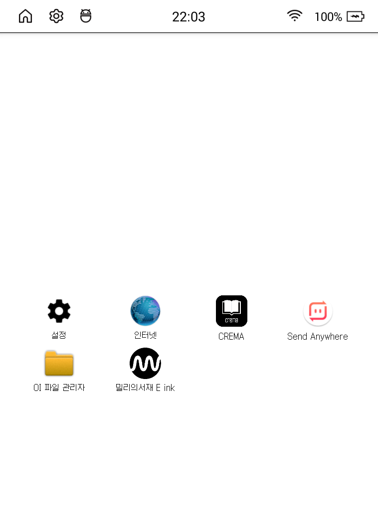

<p align="center">
  
</p>

<h1 align="center">밀밀 런처 for 사운드업</h1>

<p align="center"><b>Milmil Launcher for Sound Up</b> · 크레마 사운드업(Android 4.4)용 초경량 홈 런처</p>

[밀밀 런처](https://github.com/milmilkim/milmil-launcher)(크레마 팔레트용)를 지원 종료된 **크레마 사운드업**(Android 4.4.4 KitKat)에서 돌아가도록 옮긴 버전입니다. e-ink에 맞춰 애니메이션과 백그라운드 작업 없이 즉시 반응합니다.



### 원본과 달라진 점

- `minSdk` 21 → **19** (Android 4.4)
- 테마 `Theme.Material` → `Theme.DeviceDefault` (KitKat에는 Material 테마가 없음. 대화상자는 기기 기본 스타일로 표시)
- 앱 그리드 셀 크기: `GridLayout` spec weight(API 21+) 대신 그리드 크기를 직접 균등 분배
- 상단바: KitKat은 상단바 색을 바꿀 수 없어, 상단바 표시 중엔 컨텐츠를 상단바 아래부터 배치 (숨기기는 그대로 지원)
- 앱 이름 글꼴: [갈무리](https://github.com/quiple/galmuri) 픽셀 폰트를 기본으로 사용 (설계 크기의 정수배 + 안티앨리어싱 끔 → 저해상도 e-ink에서 또렷함). 런처 설정에서 기본 글꼴로 바꿀 수 있음
- 그 외 Android 5.0 이상에서는 원본과 동일하게 동작

## 특징

- **앱 그리드** (4열) : 홈에 표시할 앱 선택과 정렬, 숨기기
- **패널 크기** : 2줄 / 3줄 / 4줄 / 전체 화면
- **패널 위치** : 상 / 중 / 하 (전체 화면 외)
- **배경 스타일** : 투명 / 반투명 / 종이 / 액자
- **아이콘 크기** : 보통 / 크게
- **글꼴** : 갈무리(픽셀 폰트) / 기본
- **앱 아이콘 교체** : 원하는 이미지를 앱 아이콘으로 지정
- **페이지 전환** : 좌우 스와이프, 또는 물리 페이지키(`PAGE_UP` / `PAGE_DOWN`)가 있는 기기에서는 버튼으로
- 검정 텍스트와 선, 페이지 즉시 교체 (e-ink 최적화)

## 설치

[릴리스](../../releases/latest)에서 `milmil-launcher-soundup-0.3.0.apk`를 받아 설치합니다.

사운드업 설정에는 개발자 옵션 메뉴가 없어서, USB 디버깅은 숨겨진 터치로 켭니다.

1. 설정 → 기기 정보 화면을 엽니다.
2. 화면 **맨 아래 가장자리**를 가로 3등분(좌/중/우)해서 **좌 → 우 → 우 → 중 → 좌** 순서로 터치합니다.
3. USB 디버깅은 재부팅하면 다시 꺼지므로, 필요할 때마다 다시 켭니다.

```bash
adb install milmil-launcher-soundup-0.3.0.apk
```

설치 후 홈 버튼을 눌러 "밀밀 런처"를 기본 홈으로 지정합니다.

## 사용법

### 런처 설정 (빈 곳 길게 누르기)

홈 화면의 빈 영역을 길게 누르면 런처 설정이 열립니다.


- **배경화면 선택 / 제거** : 홈 배경 이미지를 지정하거나 없앱니다.
- **패널 크기** : 앱 그리드가 차지하는 높이(2줄 / 3줄 / 4줄 / 전체 화면).
- **패널 스타일** : 그리드 뒤 배경 처리(투명 / 반투명 / 종이 / 액자).
- **패널 위치** : 전체 화면이 아닐 때 그리드를 상 / 중 / 하 중 어디에 둘지 선택합니다. 전체 화면일 땐 위아래 여백을 동일하게 맞춥니다.
- **아이콘 크기** : 보통 / 크게.
- **글꼴** : 앱 이름 글꼴. 갈무리는 화면 밀도에 맞춰 Galmuri11(12px)·Galmuri14(15px) 중 원래 크기에 가장 가까운 정수배를 고릅니다.
- **상단바 표시** : 런처 화면에서 상단바를 숨기거나 표시합니다.
- **앱 숨김 관리 / 앱 순서 초기화** : 숨긴 앱을 되돌리거나 순서를 초기화합니다.

### 앱 관리 (앱 아이콘 길게 누르기)

앱 아이콘을 길게 누르면 관리 메뉴가 열립니다.


- **열기** : 앱 실행.
- **이동** : 홈에서의 순서 변경.
- **숨기기** : 홈에서 감추기(앱 숨김 관리에서 복구).
- **아이콘 변경** : 원하는 이미지를 골라 그 앱의 아이콘으로 지정합니다.
- **앱 정보** : 시스템 앱 정보 화면.
- **런처 설정** : 위 런처 설정으로 바로 이동.

### 페이지 전환

홈 화면을 좌우로 스와이프해서 페이지를 넘깁니다. 물리 페이지 넘김 키가 있는 기기에서는 상하 버튼으로도 넘길 수 있습니다.

## 설계 원칙

- Java와 플랫폼 View / XML만 사용. AndroidX, Kotlin, Compose, 외부 의존성 0개
- 애니메이션, 위젯, 백그라운드 서비스, 네트워크, 타이머 없음 (idle 작업 0)
- 저장은 SharedPreferences만
- `targetSdk 28`은 의도적 (사이드로드 전용)

## 요구 사항

- 크레마 사운드업 (CREMA-0660L, Android 4.4.4 / SDK 19, 758x1024) 펌웨어 v1.0.44에서 확인
- Android 4.4 이상 기기라면 대부분 동작 (원본 대상인 크레마 팔레트 포함)
- 루트 불필요

## 빌드 (직접 빌드할 경우)

```bash
./gradlew assembleDebug
adb install app/build/outputs/apk/debug/app-debug.apk
```

## 라이선스

MIT

포함된 갈무리 글꼴(`app/src/main/assets/fonts/Galmuri*.ttf`, v2.40.4)은 Lee Minseo(quiple)의 작품으로 [SIL Open Font License 1.1](app/src/main/assets/fonts/Galmuri-LICENSE.txt)을 따릅니다.
